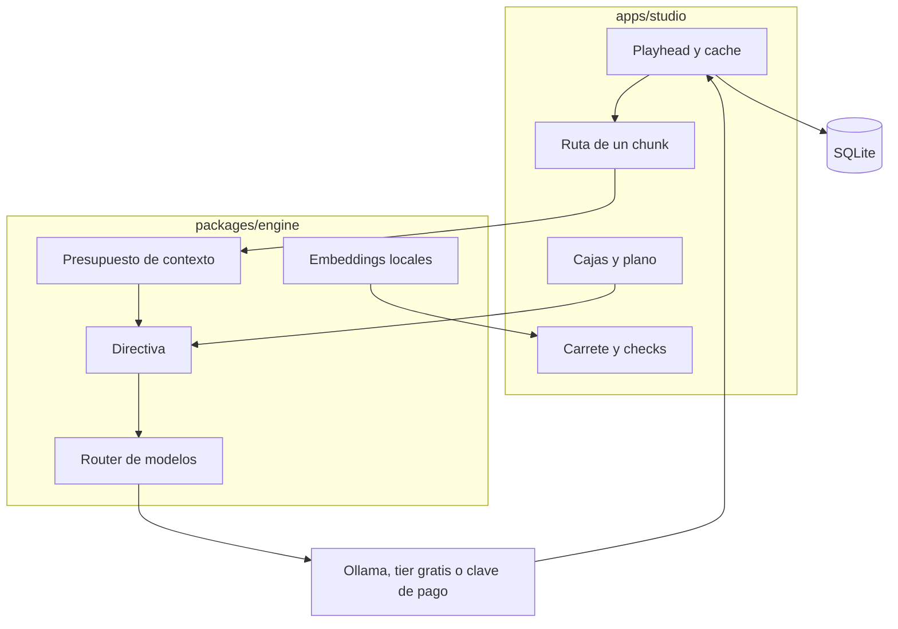

# Maestro: Echo, barato de correr

## La regla

Una llamada escribe un chunk nuevo. Todo lo demás es local.

El video de Echo ya lo dice: si volvés a pasar el cursor sobre texto generado, reaparece al instante y no se regenera. Esa caché es la optimización principal. El resto del plan existe para no romperla.

## Qué cuesta un request y qué no

Gratis, en el cliente:

- Arrastrar el playhead, el fade al borrar (~150 ms) y la máquina de escribir (20–30 ms por letra). Es playback de texto que ya está en memoria. El stream del modelo llega a su velocidad; la UI lo tipea.
- Releer una zona ya generada. Caché exacta, cero tokens.
- Mover cajas de atención y el nodo del plano: snap, spring, anillo, números, glow. No hay request mientras se arrastra.
- Teñir palabras del texto ya escrito según el polo activo. Es similitud del embedding local, no una regeneración.
- El carrete de la izquierda: muestra qué líneas y qué documentos están pesando para lo que viene. En la fase 1 las alturas están simuladas. Después salen de similitud local, sin un segundo request.
- Los checks verdes del escaneo: proyección local del chunk sobre cada factor, más coincidencia de las palabras de las cajas. El juez LLM no corre solo.

Cuesta un request, y solo uno por gesto:

- Soltar el playhead en zona vacía, o pulsar un paso. Sale un chunk (una oración, o un globo). Si el arrastre cruza cinco huecos, no se rellenan cinco: se escribe el siguiente nada más.
- "Regenerar desde aquí", cuando cambiás el rumbo y querés otra toma. La toma vieja queda en la rama, así el scrub sigue siendo gratis.
- Proponer factores nuevos. Pasa al cerrar una escena o cuando lo pedís, no en cada chunk. Puede ir al modelo más barato de la cadena.

No se hace:

- Prefetch del chunk siguiente. Si movés el plano, ese texto se tira.
- Un request por pixel, por caja o por factor.
- Rellenar automáticamente el hueco entre el cursor y la frontera.

Tope de cada llamada de escritura:

- Salida: cortar en la primera oración o globo, con un máximo de unos 80 tokens.
- Entrada: presupuesto chico y fijo, pensado para el tope más bajo (Groq anda en unos pocos miles de tokens por minuto). Entran los spans que el carrete marca más altos (del manuscrito y de los documentos), un resumen corto y, al final, la directiva. El guion entero y la biblia entera no viajan.
- El prefijo (biblia, ficha, resumen) va primero y la directiva al final, para aprovechar la caché de prompt de quien la ofrezca.

Cambiar cajas o plano no reescribe el pasado. Cambia la directiva del próximo chunk. El texto viejo se marca como generado con otro rumbo, y solo se gasta de nuevo si pedís otra toma.

## Router de modelos

Maestro no inicia sesión en el chat de ChatGPT, Claude, Gemini ni Grok. Esas suscripciones no son un endpoint. Lo que se enchufa es una clave de API del mismo proveedor, o un modelo local. Si un plan pago incluye créditos de API, esa clave entra en el mismo selector.

Tres presets, y se cambia en un menú:

- **Local.** Ollama escribe. No hay cupo y el guion no sale de la máquina. Es el que mantiene a Maestro útil sin presupuesto.
- **Gratis.** Cadena ordenada de tiers gratis que ya configuraste, por ejemplo Gemini Flash-Lite y después Groq. Un 429 pasa al siguiente. Cada proveedor usa su propia cuota, con una sola clave por proveedor. No se crean cuentas ni claves extra para multiplicar el cupo.
- **Pago.** Un modelo fijado (Gemini con facturación, Claude, GPT). Si falla por cupo, puede caer al gratis o al local, según lo dejes.

Hay tres ranuras: quien escribe, quien propone factores, y el juez. El juez viene apagado. Los embeddings del plano, el carrete y los checks son siempre locales (Transformers.js), en cualquier preset.

Las claves viven en un archivo gitignored, editables desde la mesa. Agregar un proveedor es una entrada en el registro del AI SDK, no un cambio de la UI.

## Contexto que ya existe, y lore que cambia

Maestro no asume una historia en blanco. Un proyecto abre con los documentos que ya tenés: ficha de personaje, saga, lore, notas de trama. Cada uno se parte en spans. Eso es el canon de partida.

Hay dos modos, y los dos usan la misma mesa:

- **Continuar.** Los documentos aceptados atan la generación. El presupuesto elige los spans más altos del carrete, no el archivo completo. La directiva pide respetar esa versión, y un chequeo local marca si un chunk nuevo la pisa. No es una prueba formal: es un aviso para corregir o para pasar a revisar el lore.
- **Revisar lore.** Cuando la trama ya movió algo (una lealtad, un secreto, una herida), Maestro propone un parche sobre el documento, en diff. Aceptarlo crea una versión nueva. La anterior queda. La próxima generación lee solo la versión aceptada.

El carrete es el lugar donde se ve cuál de las dos cosas está pasando: si pesa la saga vieja, si pesa el último globo, o si un parche recién aceptado ya entró al pack.

## Carrete de atención

Panel vertical a la izquierda del manuscrito, de unos 70 px. Una barra por línea visible, alineada a esa línea, como en la captura. Si el pack de contexto incluye un span de un documento que no está en la página, su barra va en una franja corta arriba del carrete. El tooltip dice de qué documento sale.

Altura de 0 a 100, normalizada con percentil 95 para que una sola barra no se coma el panel. Color de apagado a activo a pico. Glow suave cuando pasa de 70%. Respiración de 2% en un loop de 3 s. Mientras llega un chunk, un shimmer de abajo hacia arriba. Al rebobinar, la barra no se borra: queda gris al 30% porque el chunk sigue en caché. Hover: tooltip con el score y el texto del span. Copy del panel: "Muestra qué partes de tu historia influyen más en la próxima generación. Arrastra las cajas para cambiar el foco."

Mover una caja hace scale en Y y sube el color de las barras que cubre. Con varias cajas, la altura es la suma ponderada.

El score de la fase 1 es simulado y reacciona a las cajas, para poder ver la mesa sin modelo. El score real, en la fase 3, es la similitud coseno entre el embedding del span y el embedding del rumbo (palabras de las cajas más el polo activo). Ollama no devuelve los pesos de atención del transformer por su API de chat. Esos pesos, si llegan, vienen del runtime de la fase 4 y reemplazan el coseno sin cambiar la barra.

Performance: solo se pintan unas 30 barras más un buffer, el recálculo de alturas espera 100 ms, y la animación mueve `transform`, no `height`.

## Interacción, como en la captura

- **Timeline.** Barra inferior, playhead vertical. A la derecha, en zona vacía: glow azul mientras llega el chunk, máquina de escribir, y al terminar el glow se apaga. A la izquierda: el bloque se va en fade y slide (~150 ms) y queda en caché. Volver a la derecha sobre esa zona lo restaura al instante.
- **Cajas.** Varias, semitransparentes, borde fino, peso en una etiqueta ("Atención: 0.8"), snap a la palabra (~50 ms), spring al soltar (~200 ms), líneas punteadas al span. El peso entra en la directiva del próximo chunk.
- **Factores.** A la derecha, chips con porcentaje: tono, tensión, foco, los que la historia pida. Abajo, un arco para el factor activo (en la captura, tierno a sombrío) con el nodo sobre la curva y una leyenda del estilo "tono: 73%". El nodo tiene inercia y un overshoot corto. El arco y los chips son locales. Todos los factores activos viajan juntos en la misma directiva.
- **Escaneo.** Al asentarse un chunk, un check por factor que la proyección local da por cumplido. Si querés una segunda lectura, el botón del juez gasta un request del modelo barato.
- **Mesa.** Fondo `#0a0a0a`, grilla de 20 px, JetBrains Mono para el texto generado, Inter para los controles, hover leve, transiciones de menos de 300 ms. Motion para los springs. El timeline es un playhead, no un grafo: no hace falta Konva ni React Flow.

El perfil cómic cambia la forma del chunk, no la mesa. Un chunk es un globo (hablante y tipo) y, al abrir viñeta, una línea de acción. La ficha del personaje es un documento de contexto más: se importa, se versiona y entra al carrete como cualquier saga. El letrado avisa en local si el globo se pasa de largo.

## Plano

- [`packages/engine/src/router.ts`](packages/engine/src/router.ts): presets, cadena y fallback en 429.
- [`packages/engine/src/budget.ts`](packages/engine/src/budget.ts): arma el prefijo dentro del tope y corta la salida.
- [`packages/engine/src/cache.ts`](packages/engine/src/cache.ts): clave por rama, índice y firma de rumbo. El scrub no la invalida.
- [`packages/engine/src/local.ts`](packages/engine/src/local.ts): embeddings, carrete, tinte y checks.
- [`apps/studio/app/api/unit/route.ts`](apps/studio/app/api/unit/route.ts): un chunk, streaming, cancelable.

## Fases

- **Fase 1, la mesa.** Sin claves y sin modelo. Manuscrito de muestra, carrete simulado, cajas, arco, chips y playhead que muestra y esconde líneas. Cajón para pegar documentos y verlos partidos en spans. Sirve para mirar si la interfaz se siente como la captura.
- **Fase 2, que escriba.** Persistencia, caché, presupuesto, router y un chunk por gesto. El pack que se manda es el que el carrete tiene en alto.
- **Fase 3, que respete y actualice.** Score real del carrete. Parche de lore con diff y versiones. Resumen extractivo en local. Resumen de modelo solo al cerrar una página.
- **Fase 4, laboratorio.** Activation steering en Python. El score del carrete puede pasar de coseno a atención real del modelo, con la misma barra.

## Fuera de alcance

Dibujo, globos sobre arte, logit bias, cuentas, y cualquier puente que use la sesión del chat de ChatGPT, Claude, Gemini o Grok.

## Verificación

Fase 1, en el browser y sin red: el manuscrito se lee en la mesa oscura; mover una caja cambia las barras; rebobinar las deja grises; el arco y los chips se mueven sin requests; pegar un documento lo parte en spans en el cajón. Fase 2, con local y con una clave gratis: rebobinar no llama al modelo; un gesto llama una vez; un 429 pasa al siguiente de la cadena. Fase 3: aceptar un parche cambia lo que el próximo chunk recibe, y la versión anterior sigue en el documento.
